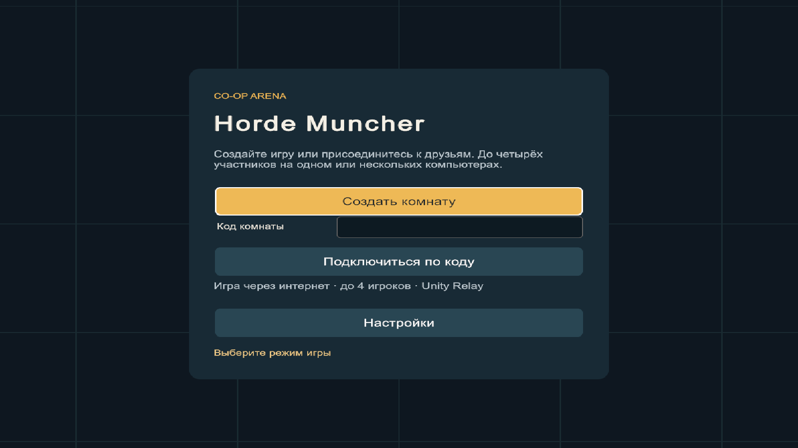
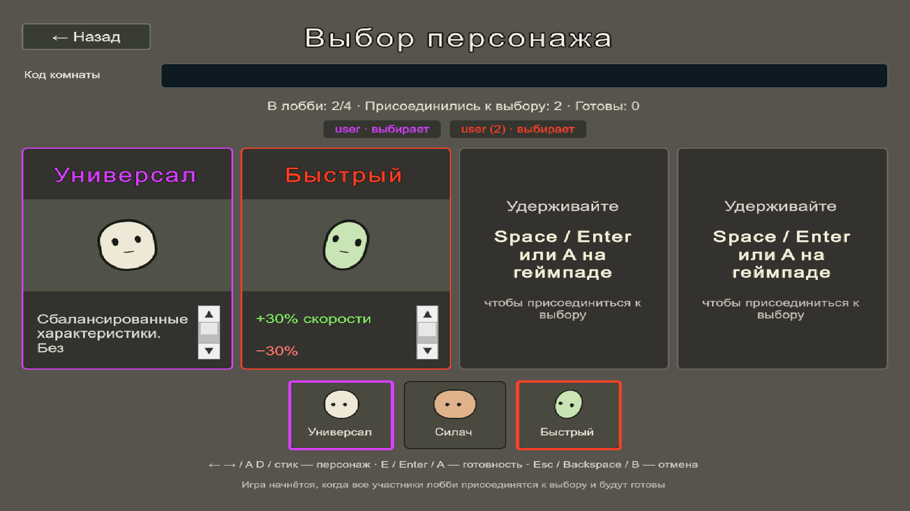
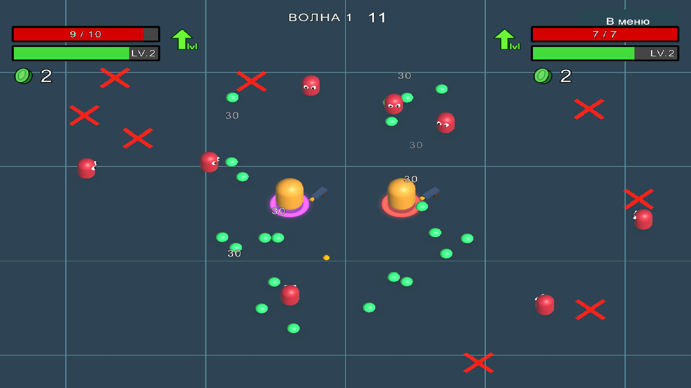
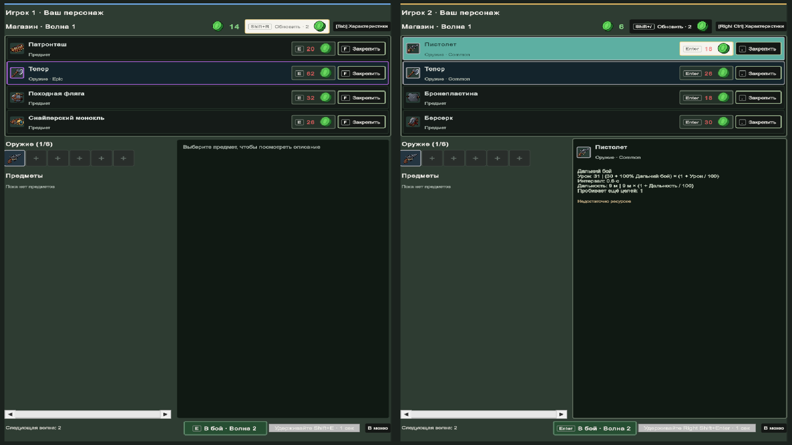

# Horde Muncher

Кооперативный 3D arena roguelike по мотивам Brotato. До четырёх игроков, волны врагов, автоматическая стрельба и магазин между боями.

Разрабатываю с помощью Codex.

## Стек

- Unity 6.6 и C#.
- DOTS: Entities, Burst, Jobs.
- Netcode for Entities, Unity Authentication и Relay.
- URP, UI Toolkit, Input System.
- Unity Test Framework.

## Скриншоты

Меню входа

Выбор персонажей для двух игроков

Бой вдвоём

Магазин для двух игроков

